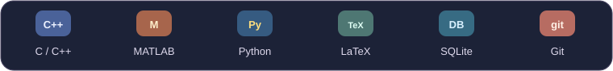
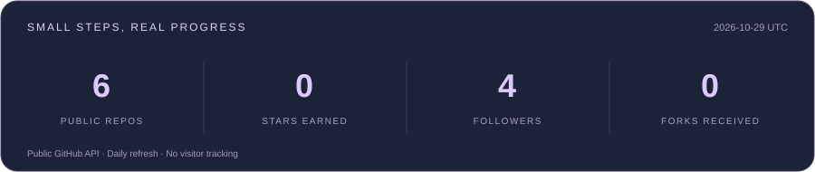

  

  

<h3 align="center">Hi, I'm frostmoon-rui 🌙</h3>

  Numerical computing, algorithm implementation, and ongoing work on Python bots and automation tools. 
  Exploring how mathematical models become code and how that code holds up in everyday use.

  <a href="https://github.com/frostmoon-rui/gmn_bot">🐾 Lucky Cat</a>
  &nbsp; · &nbsp;
  <a href="https://github.com/frostmoon-rui?tab=repositories">📦 My repositories</a>
  &nbsp; · &nbsp;
  <a href="https://github.com/frostmoon-rui/gmn_bot/issues">💬 Questions and feedback</a>

---

### 🐾 Raising a little cat · gmn_bot

[**Lucky Cat · Cat Butler**](https://github.com/frostmoon-rui/gmn_bot) is a QQ bot project under ongoing development.

- 🧠 Chat across multiple models, with priorities adjusted to their performance in use.
- 🌦️ Weather from multiple sources, maps, and travel information for everyday reminders.
- 🍜 Local food discoveries, connected with [CacheTide](https://github.com/CacheTide)'s public food map.
- 🐱 Stickers, video summaries, and background search, steadily adding to this cat's skills.

> One small thing done well at a time.

### 🧰 Tools and practice

  

| Area | Tools and practice |
| --- | --- |
| Algorithm implementation | C / C++; pointers and memory management, recursion and iteration, numerical algorithms |
| Scientific computing | MATLAB; matrix operations, numerical solutions of ordinary differential equations, dynamical system simulation and visualization |
| Mathematical modeling | Linear algebra, differential equations, probability and statistics; error analysis and local stability analysis |
| Bots and automation | Python; asynchronous tasks, API integration, data processing, caching, and error recovery |
| Document tools | LaTeX / Beamer; equations, theorem environments, and bibliography typesetting; Word VBA macro automation |
| Supporting tools | Git, SQLite, JSON; HTML / CSS / JavaScript and PowerShell scripts |

### 🔬 Numerical computing practice

- **Numerical integration:** Implement composite rectangle, trapezoidal, and Simpson rules in C, comparing absolute error, relative error, and convergence at different step sizes.
- **Dynamical system simulation:** Solve nonlinear ordinary differential equations in MATLAB, analyze local stability using equilibria and Jacobian eigenvalues, and plot time responses and phase portraits.

### 🌌 Small steps, steady progress

  

  Statistics come from the public GitHub API and refresh daily. No private repositories or visitor tracking.

---

🌙 May every commit bring you a little closer to a life you love.

